# Service Business Finance & HR System

**An end-to-end finance, payroll and reporting system for a multi-branch service business in Saudi Arabia — from the cashier's daily entry to a coded general ledger, auto-updating financial statements, KSA VAT tracking and a web app for the owner.**

> Built for a real client. This repository is an anonymized version with **synthetic data only** — no client names, figures or credentials.

---

## The story

It started as a one-off request: a set of organized Google Sheets covering HR, finance and cash management — clean structure, dropdowns, linked categories — plus a Power BI report on top.

The client liked the result enough to put the work on a **monthly retainer**. Over the following months the sheets evolved, version by version and driven by real feedback, into a connected system — and finally into a web app the owner uses instead of opening spreadsheets.

---

## The problem

| Before | Impact |
|---|---|
| Purchase invoices and expenses arriving as WhatsApp messages | No consistent classification, hard to audit |
| Sales collected through 5 payment channels (POS, cash, online, Tabby, Tamara) | Cash drawer rarely matched the system |
| Payroll with commissions, targets, overtime, advances and deductions calculated by hand | Time-consuming and error-prone every month |
| VAT due vs. VAT actually paid not tracked | Outstanding tax liability invisible to the owner |
| Years of records spread across separate yearly files | No single view of business performance |

---

## The solution

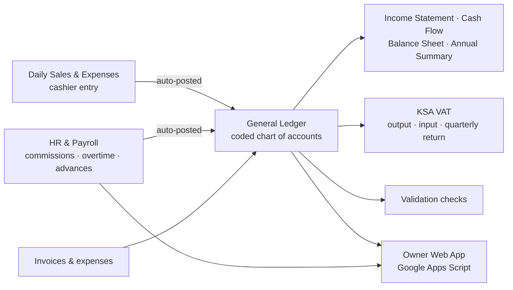

### 1. Daily sales & expenses (cashier file)
- Built for a **non-specialist cashier**: Arabic RTL layout, dropdowns, protected formula cells, a built-in "how to use" guide
- Sales recorded by **5 payment channels** and reconciled against the actual cash and card totals, with a clear surplus / shortage status per day
- Up to 10 expense lines per day (4 visible, 6 expandable), each tagged by type and employee
- Daily net profit with a health flag; months collapsed to totals by default
- Auto-generated expense log and an interactive report filtered by month, employee and expense type
- Compensation tracker for free services: auto-pricing from a service list, reasons, employee breakdown

### 2. HR & payroll
- Monthly payroll per employee: base salary, transport and 12-hour-shift allowances
- **Sales-based pay**: commission rules plus a target bonus
- Overtime hours, extra working days, absence and lateness deductions computed from day and hour rates
- Advances, cash taken from the drawer and tips tracked separately so net pay is always explainable
- Employee costs (visas, sponsorship transfer, medical insurance) recorded once and flowing into finance

### 3. Finance — general ledger & statements
- One **ledger** holding every transaction since 2022, migrated from separate yearly files
- Each line mapped through a **coded chart of accounts** to its classification, nature and target statement
- **Automatic monthly postings** generated from the daily sales file and payroll — no double entry
- **Income statement, cash flow & balances, balance sheet** and a multi-year annual summary, all driven by a year / month selector on a dashboard
- Account suggestions and alerts for lines that look misclassified
- A **validation sheet** running checks across the whole workbook (✓ / ⚠) before any report is trusted

### 4. KSA VAT
- 15% output and input VAT calculated per ledger line, with tax numbers and invoice references
- Quarterly return view
- VAT **due vs. paid vs. outstanding**, with the unpaid balance carried as a liability (paid in instalments)

### 5. Owner web app
- Built with **Google Apps Script** on top of the sheets — Arabic, right-to-left, works on phone and desktop
- **Dashboard:** revenue, expenses, net profit and payroll for any period, with monthly trends
- **Payroll:** every employee's dues, deductions and net pay, with actions for attendance, bonuses, salary changes and advances
- **Finance:** income statement, cash flow, balance sheet, VAT by quarter, the month's ledger, and expenses by category and supplier
- **Analytics:** payroll-to-revenue ratio, return on every riyal of salary, fixed vs. variable costs, profit margin trend
- **Team:** employee records with alerts for residency permits, work permits, insurance and contracts about to expire
- Simple data entry (new employee, salary change, invoice, expense, revenue) written straight back to the sheets — the owner no longer opens a spreadsheet

**▶ [Live demo](https://omarhamdymostafa.github.io/service-business-finance-system/demo/webapp/)** — the real interface running on synthetic data (saving is disabled).

| Dashboard | Finance |
|---|---|
| 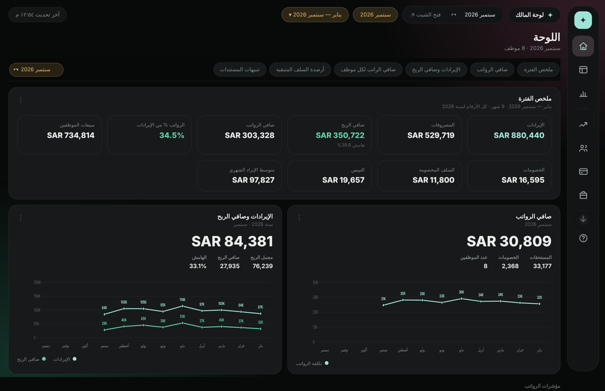 | 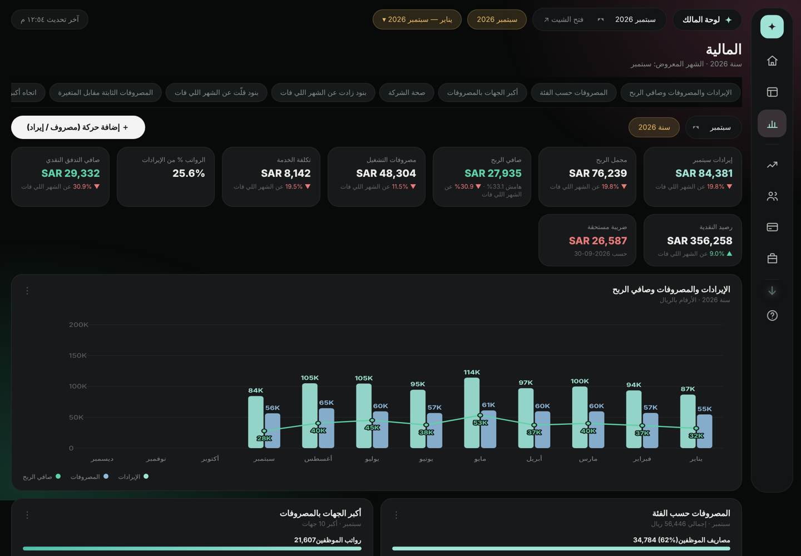 |

| Payroll | Analytics |
|---|---|
| 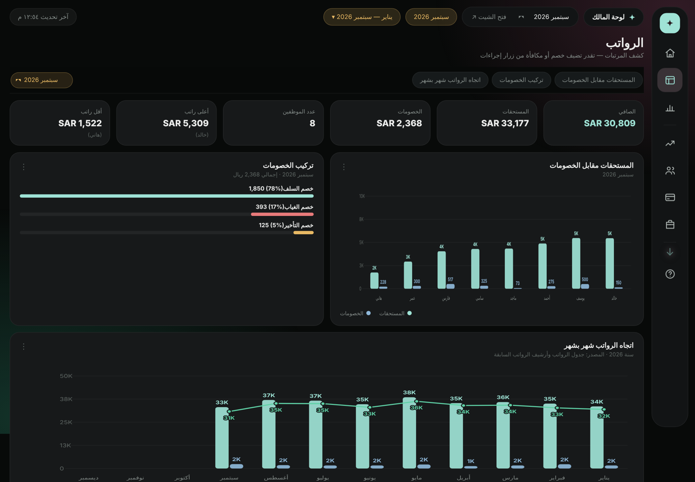 | 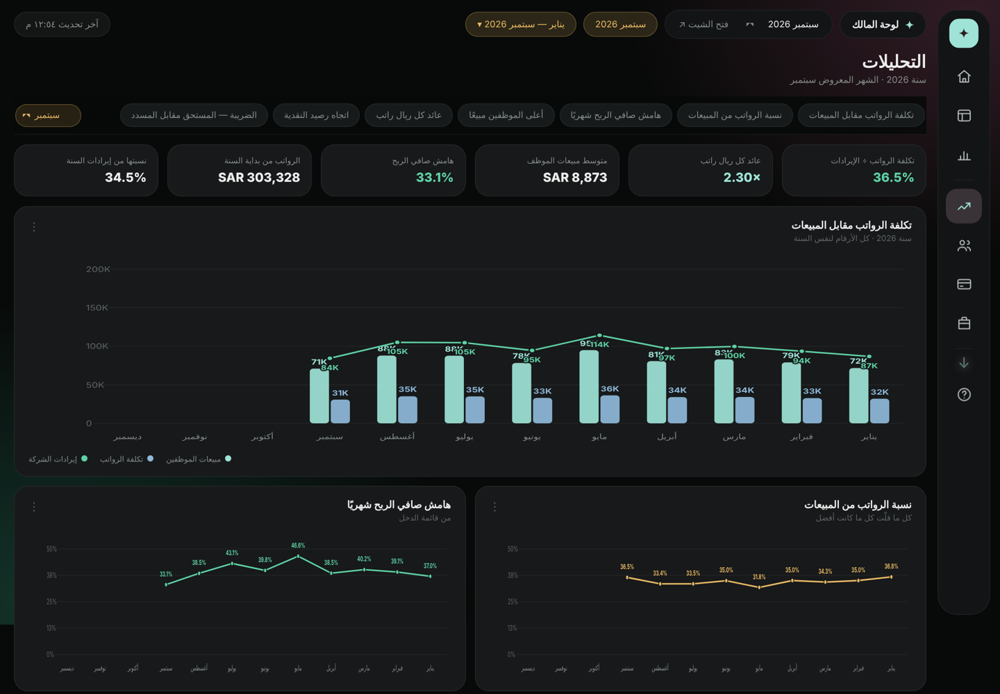 |

| Team & document alerts |
|---|
| 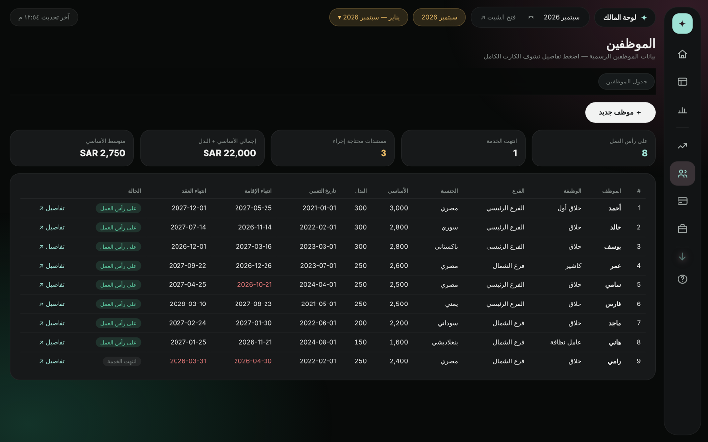 |

### 6. Power BI report
- Management view of sales, expenses and profitability on the same data

---

## How it was built

- **Modular build scripts in Python (openpyxl):** each workbook is generated by numbered scripts sharing one style module, with layout metadata passed between scripts instead of hard-coded column letters — layout changes never break formulas
- **Validated before delivery:** every formula tested against realistic data and recalculated to surface errors
- **Iterative delivery:** numbered versions refined through client feedback

| Layer | Tools |
|---|---|
| Data entry & storage | Google Sheets |
| Workbook generation | Python · openpyxl |
| Web app | Google Apps Script · HTML/CSS |
| Reporting | Power BI |

---

## Results

| Area | Before | After |
|---|---|---|
| Accounting | No books, no monthly close | Coded general ledger with automatic monthly postings |
| Financial statements | None — the owner had no P&L | Monthly income statement, cash flow and balance sheet, plus a multi-year summary |
| Payroll | Built by hand each month, pulling data from several sources | One payroll sheet computing commissions, targets, overtime, deductions and advances automatically |
| Cash control | No daily reconciliation | Daily reconciliation per payment channel with surplus / shortage flags |
| VAT | Liability not tracked | VAT due, paid and outstanding visible at any time |
| History | Records split across yearly files | 4+ years (2022 → today) in a single ledger |
| Owner access | Several spreadsheets to open | Opens a web app with live payroll and financials |

**The engagement grew from a one-off spreadsheet request into a monthly retainer.**

---

## Demo workbook

[`demo/finance-system-demo.xlsx`](demo/finance-system-demo.xlsx) is a working replica of the system's core with three months of **synthetic data** — 1,190+ live formulas, Arabic right-to-left like the production files. Only the yellow cells are inputs; everything else recalculates.

| Daily sales, drawer expenses & cash reconciliation |
|---|
| 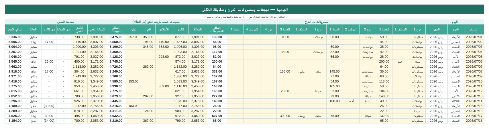 |

| Payroll — commissions, target bonus, overtime, advances pulled from the daily sheet |
|---|
| 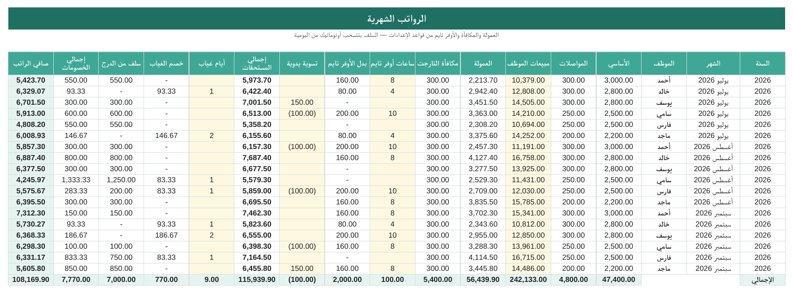 |

| General ledger — manual invoices + automatic monthly postings (shaded) |
|---|
| 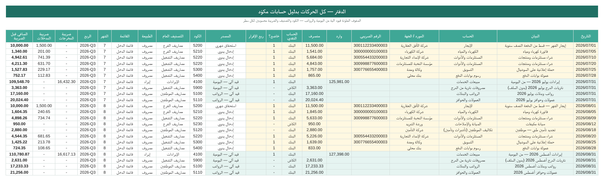 |

| Income statement | KSA VAT | Validation |
|---|---|---|
| 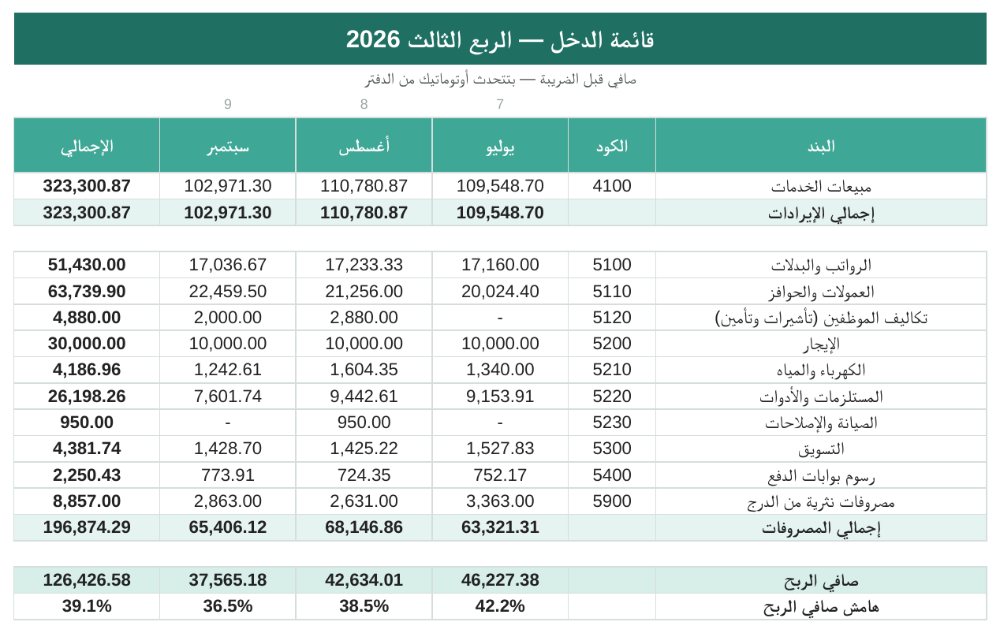 | 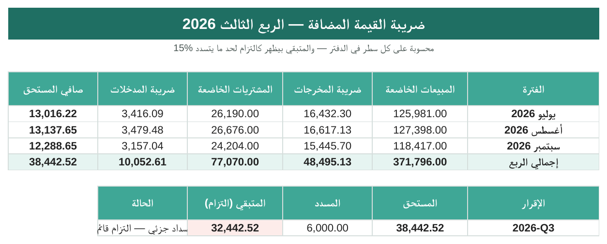 | 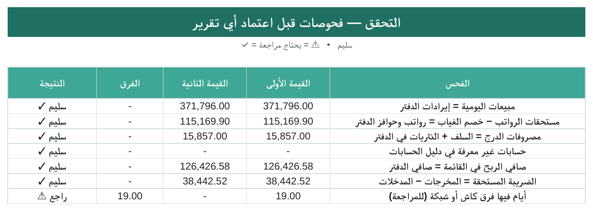 |

| Settings — lists, chart of accounts, payroll rules |
|---|
| 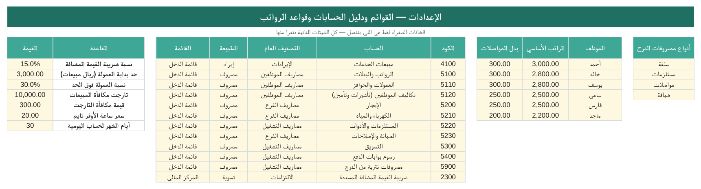 |

### Rebuild it

```bash
pip install openpyxl
python src/build/build.py        # writes demo/finance-system-demo.xlsx and sample-data/*.csv
```

Open the file in Excel or LibreOffice to calculate. Change a payroll rule or a salary in **الإعدادات** and watch payroll, ledger, income statement and checks update.

---

## Repository structure

```
demo/             Demo workbook + browser demo of the web app (demo/webapp)
screenshots/      Sheet screenshots (synthetic data)
src/build/        Python scripts that generate the demo (style · data · build)
src/apps-script/  Owner web app source (Code.gs + Index.html)
src/webapp-demo/  Mock data layer that runs the web app without Google
sample-data/      Synthetic inputs as CSV
```

---

## About me

**Omar Hamdy** — Financial Data Analyst with an accounting background, building automated finance and reporting systems for businesses in Egypt and Saudi Arabia.

[LinkedIn](https://www.linkedin.com/in/omar-hamdy-3a8b82110/)
